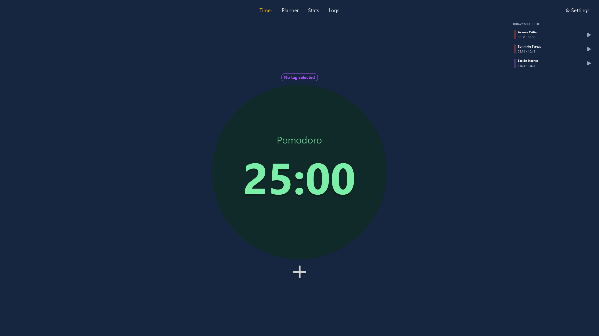
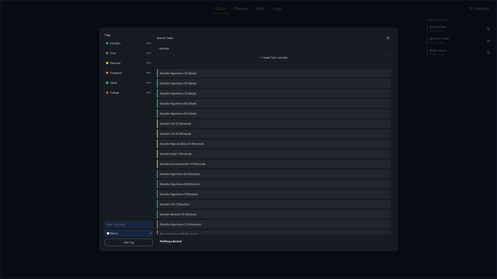
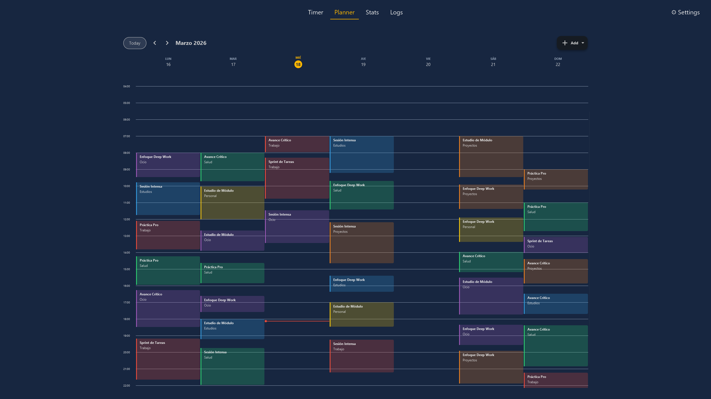
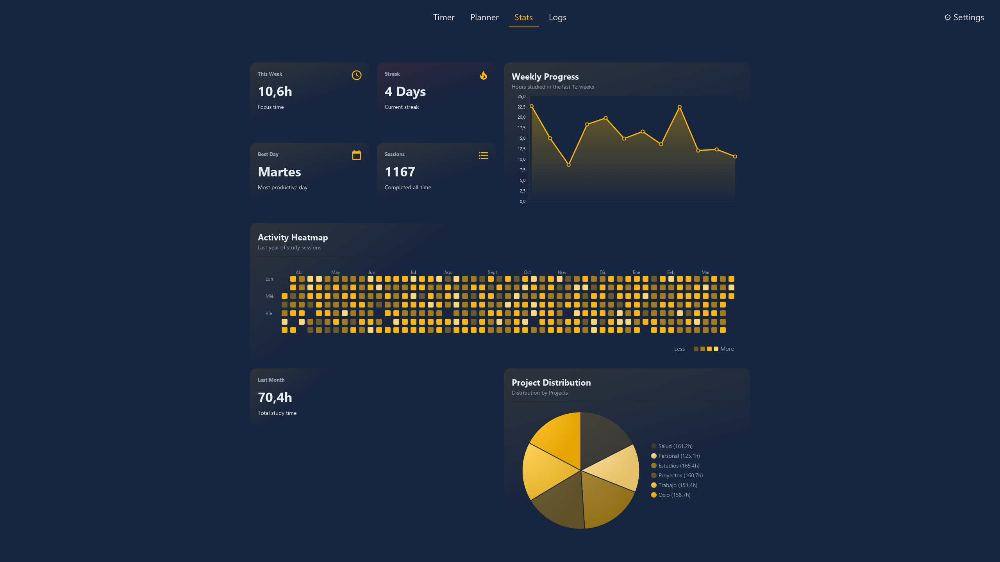
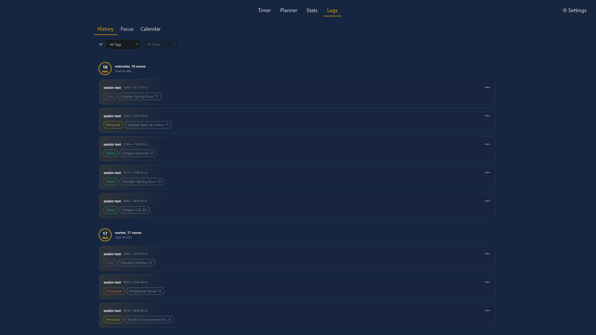
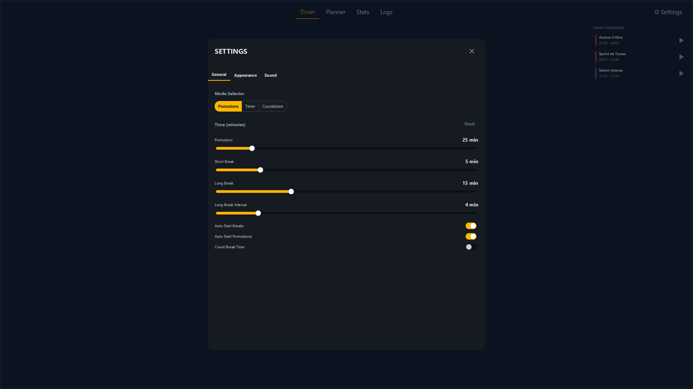

# 🎓 StudyZen

StudyZen is a self-hosted study platform for people who want a personal study system they fully control.

It brings together focused session tracking, weekly planning, tasks, deadlines, logs, and progress insights in one place, while keeping your data on your own machine through a local backend.

## 🚀 Main Features

### ⏱️ Focus Tracking

- Pomodoro, Timer, and Countdown modes
- Session title, notes, duration, and rating
- A cleaner record of what you actually studied

### 📅 Planning

- Weekly planner
- Scheduled study blocks
- Deadlines and daily todos
- Tag and task organization

### 📊 Review

- Logs by history, calendar, and focus area
- Statistics dashboard with visual summaries
- Better feedback on workload and consistency

### 🌐 Web Experience

- Responsive study planning and session tracking
- Multiple themes and accessible interface controls
- Browser-based access to your self-hosted StudyZen instance

## 🖼️ Gallery

| Timer                     | Search                     |
|---------------------------|----------------------------|
|  |  |

| Planner Daily View                     | Planner Weekly View                     |
|----------------------------------------|-----------------------------------------|
|  |  |

| Stats                     | Log History                     |
|---------------------------|---------------------------------|
|  |  |

| Log Focus                     | Settings                     |
|-------------------------------|------------------------------|
|  |  |

## ⚙️ How It Works

StudyZen runs as a local self-hosted setup:

- a web frontend for the UI
- a backend API for data persistence
- a PostgreSQL database for storage

Docker Compose starts the web frontend, backend, and database locally. The application is available at `http://localhost:7777`, and the backend API at:

```text
http://localhost:8080/api
```

## 🧭 Getting Started

### 1. 🛠️ Configure the local environment

Copy the example file:

```bash
cp .env.example .env
```

Default local setup:

```env
BACKEND_PUBLIC_PORT=8080
BACKEND_PRIVATE_PORT=8080
DB_PORT=5432
DB_NAME=studytracker
DB_USER=your_user
DB_PASSWORD=your_password
API_URL=http://localhost:8080/api
```

### 2. 🐳 Start the backend

You can do this in either of these ways:

- from the project root with the repository files
- from the backend release package `StudyZen-backend-v<version>.zip`

If you are using the backend package, extract it and work from:

```text
studyzen-backend/
```

That package is documented in [README-backend.md](README-backend.md).

Then start the services:

```bash
docker compose up -d
```

### 3. 🌐 Open StudyZen

Open the web application at:

```text
http://localhost:7777
```

The frontend connects to the backend API through the configured local setup.

## 📦 Release Artifacts

The backend can be shipped separately as:

- **StudyZen Backend**: `StudyZen-backend-v<version>.zip`

That backend package is intended to contain:

- `docker-compose.yml`
- `.env.example`
- `README-backend.md`

## 🧪 Build From Source

To run the project locally, you will need:

- Node.js and npm for the web frontend
- Java 21 and Maven 3.9+ for the backend
- Docker Desktop

Start the application stack:

```bash
docker compose up -d
```

For frontend development, run `npm install` and `npm run dev` from `frontend-web/`.

## 🗂️ Project Layout

```text
StudyZen/
├── backend/          # Java 21, Spring Boot, PostgreSQL, Flyway
├── frontend-web/     # React, TypeScript, Vite, Tailwind CSS
├── .env.example
├── docker-compose.yml
├── Dockerfile
├── LICENSE
├── pom.xml
└── README.md
```

## 🧱 Tech Stack

| Layer | Technology |
|---|---|
| Frontend | React, TypeScript, Vite, Tailwind CSS |
| Backend | Java 21, Spring Boot 3 |
| Database | PostgreSQL 16 |
| Deployment | Docker Compose |

## 📄 License

StudyZen is licensed under the MIT License. See [LICENSE](LICENSE).

## 👤 Author

Fran Dorado
