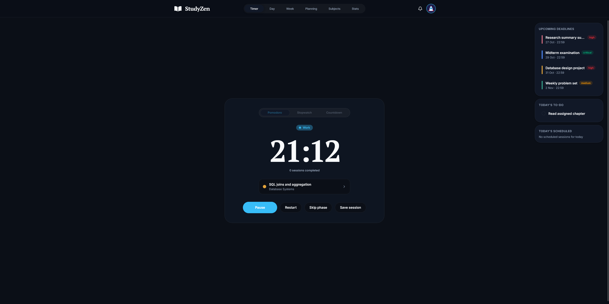
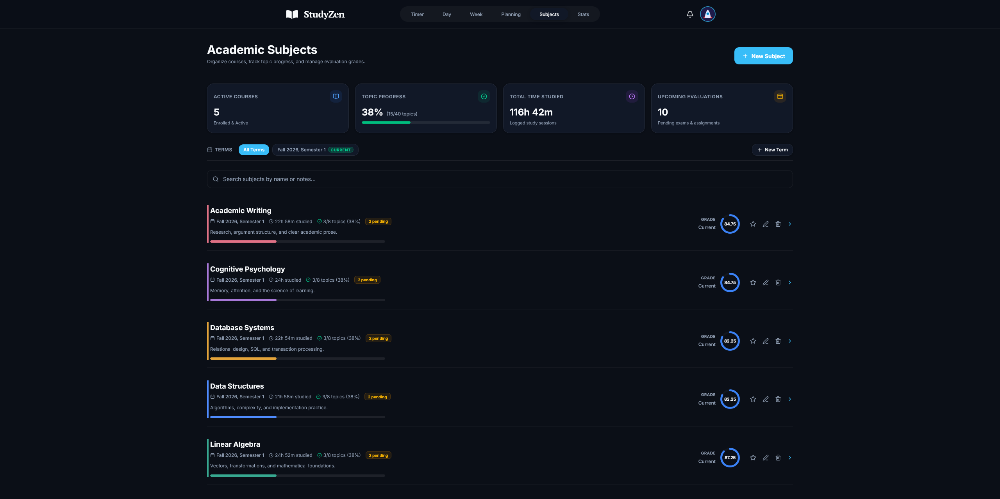
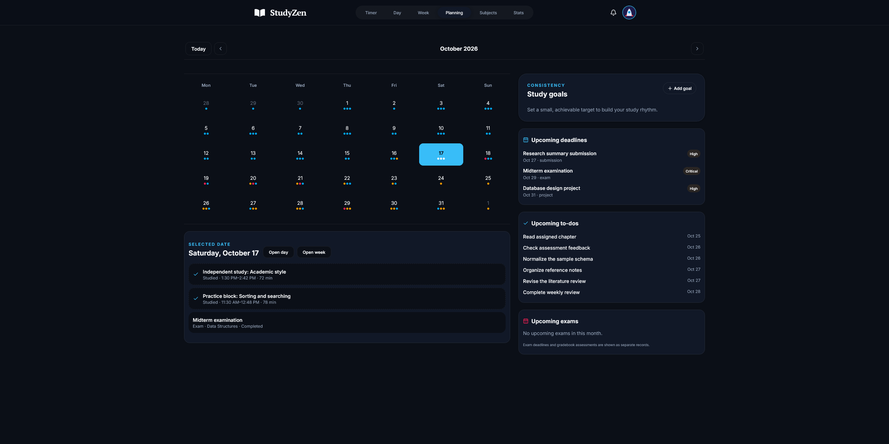
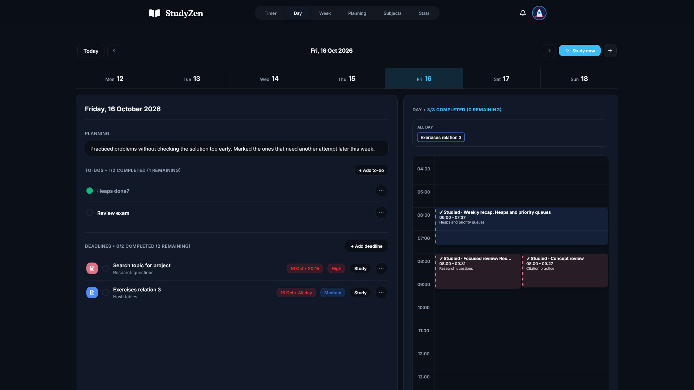
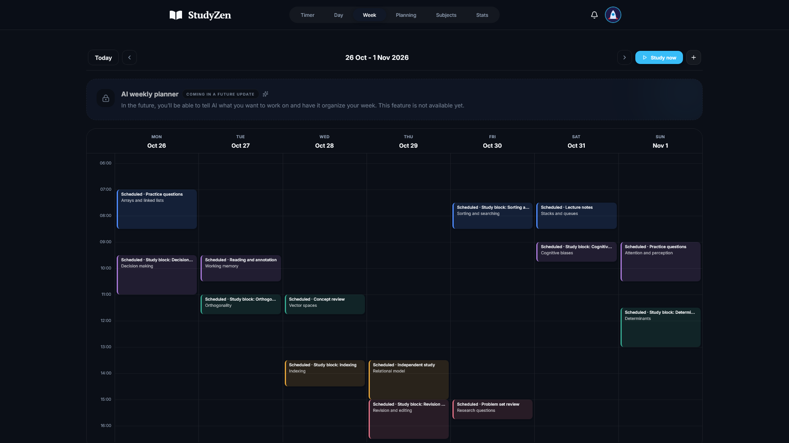
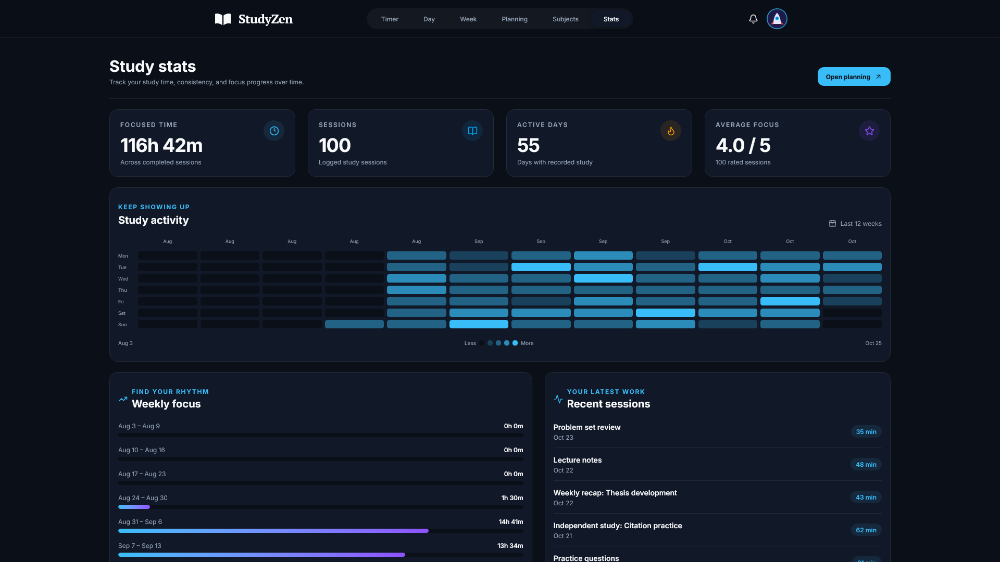

# StudyZen

A self-hosted study platform for planning academic coursework, tracking focus sessions, and reviewing progress over time. Built with React 19, Spring Boot 3, and PostgreSQL.

<p align="center">
  
</p>

---

## Overview

StudyZen brings personal study tools together in a single self-hosted web application:

- **Focus Timers**: Pomodoro intervals, countdown, and stopwatch modes with configurable audio signals, session notes, and post-session concentration self-evaluations.
- **Academic Hierarchy**: Organize study work by academic terms, courses, modules, and topic checklists, with tracking for evaluation weights and recorded grades.
- **Multi-Scale Planning**: Reconcile monthly exam deadlines with an hour-by-hour daily timeline and weekly workload distribution to avoid exam-week rushes.
- **Telemetry and History**: Detailed activity records, cumulative study hours, subject distribution charts, and daily focus trends over time.
- **Personalization**: Multiple curated color palettes with real-time CSS variable bindings, dark and light modes, and customizable timer sounds.

---

## Application Views

### Coursework and Subject Hierarchy

Group coursework across terms, courses, and individual topic lists. Track upcoming assessments, weight percentages, and recorded grades in one structured place.

<p align="center">
  
</p>

### Planning Calendar

A unified monthly perspective for mapping study sessions, assignment deadlines, and exam milestones.

<p align="center">
  
</p>

### Daily Timeline and Weekly Workload

Balance preparation across seven days and execute each day through an hourly time-blocked schedule with prioritized study goals.

<table>
  <tr>
    <td width="50%">
      <p align="center"><strong>Daily Timeline</strong></p>
      
    </td>
    <td width="50%">
      <p align="center"><strong>Weekly Distribution</strong></p>
      
    </td>
  </tr>
</table>

### Study Analytics and Performance

Inspect total hours logged per course, review past session notes, and monitor concentration ratings across weeks and months.

<p align="center">
  
</p>

---

## Architecture

| Layer | Technologies |
|---|---|
| **Frontend** | React 19, TypeScript, Vite, Tailwind CSS 4, Lucide Icons |
| **Backend** | Java 21, Spring Boot 3, Spring Security (JWT, OAuth2), Hibernate / JPA |
| **Database** | PostgreSQL 16, Flyway database migrations |
| **Orchestration** | Docker Compose, multi-stage Docker builds, Nginx reverse proxy |

---

## Quickstart with Docker Compose

### Prerequisites

- Docker Desktop or Docker Engine with the Compose plugin

### Setup and Launch

1. Create a local environment file from the provided example:

   ```bash
   cp .env.example .env
   ```

2. Edit `.env` to configure your database password and generate a secure `JWT_SECRET` (minimum 32 characters):

   ```bash
   # Generate a 32-byte secret using OpenSSL:
   openssl rand -base64 32

   # Or using Node.js:
   node -e "console.log(require('crypto').randomBytes(32).toString('base64'))"
   ```

   For local HTTP development, keep `COOKIE_SECURE=false`. If serving over HTTPS through a reverse proxy, set `COOKIE_SECURE=true`.

3. Build and launch the containers in the background:

   ```bash
   docker compose up -d --build
   ```

4. Access the web interface at `http://localhost:7777`.

The frontend container proxies `/api` and authentication endpoints internally to the Spring Boot backend. The backend is also directly reachable at `http://localhost:8082/api`.

### Useful Commands

- Inspect service logs: `docker compose logs -f`
- Stop the stack without losing data: `docker compose down`
- Stop the stack and remove persistent data: `docker compose down -v`

---

## Environment Configuration

The root `.env.example` configures the entire stack. Key variables:

| Variable | Description | Default |
|---|---|---|
| `DB_NAME` | PostgreSQL database name | `studyzen` |
| `DB_USER` | PostgreSQL user account | `studyzen_user` |
| `DB_PASSWORD` | PostgreSQL password (choose a strong value) | `studyzen_secret` |
| `JWT_SECRET` | Required secret for signing authentication tokens | (placeholder) |
| `FRONTEND_PORT` | Exposed host port for the web frontend | `7777` |
| `BACKEND_PUBLIC_PORT` | Exposed host port for the backend API | `8082` |
| `BACKEND_PRIVATE_PORT` | Internal port used by the backend container | `8080` |
| `FRONTEND_URL` | Public origin of the web client | `http://localhost:7777` |
| `CORS_ALLOWED_ORIGIN` | Allowed origin for backend CORS requests | `http://localhost:7777` |
| `COOKIE_SECURE` | Set `true` when behind HTTPS; `false` for local HTTP | `false` |
| `GOOGLE_CLIENT_ID` | Optional Google OAuth2 client ID | (empty) |
| `GOOGLE_CLIENT_SECRET` | Optional Google OAuth2 client secret | (empty) |
| `SMTP_*` | Optional mail delivery configuration for password recovery | (empty) |
| `VITE_API_BASE_URL` | Frontend API path prefix (proxied by Nginx) | `/api` |

Never commit the `.env` file with production secrets to version control.

---

## Local Development

### Frontend (`frontend-web/`)

Requirements: Node.js 20+ and npm.

```bash
cd frontend-web
npm install
npm run dev
```

The Vite development server runs at `http://localhost:7777` and proxies backend requests to `http://localhost:8082` by default.

To run lint checks and build the production bundle:

```bash
npm run lint
npm run build
```

### Backend (`backend/`)

Requirements: Java 21 JDK and Maven.

Ensure a PostgreSQL instance is running with the credentials specified in your environment, then start the application from the repository root:

```bash
mvn -pl backend -am spring-boot:run
```

For standalone backend container deployments, refer to [README-backend.md](README-backend.md).

---

## Project Structure

```text
StudyZen/
├── backend/
│   ├── src/main/java/com/studyzen/      # Controllers, services, models, security
│   ├── src/main/resources/db/migration/ # Flyway database migration scripts
│   └── pom.xml                          # Maven build configuration
├── frontend-web/
│   ├── src/components/                  # Modular React UI components
│   ├── src/pages/                       # Application pages and routing
│   ├── src/context/                     # Auth, Timer, Theme, and Toast state
│   ├── src/services/                    # HTTP client and API integration
│   └── package.json                     # Dependencies and scripts
├── images/                              # Application screenshots and assets
├── docker-compose.yml                   # Multi-service container orchestration
├── Dockerfile                           # Production container build definition
└── .env.example                         # Environment template
```

---

## License

This project is licensed under the MIT License. See [LICENSE](LICENSE) for details.
